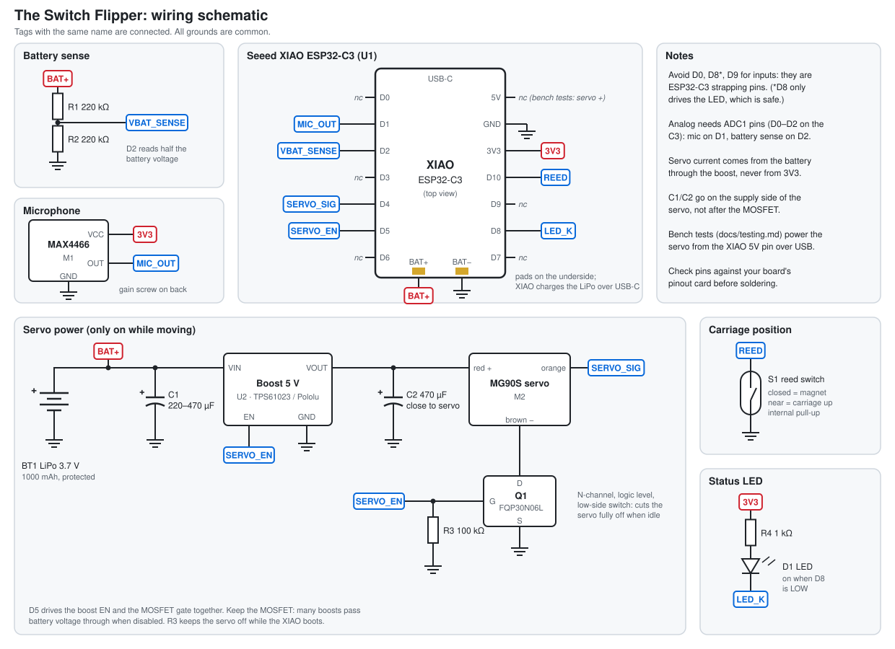

# The Switch Flipper

A 3D-printed box that fits over an ordinary wall light switch and flips it for
you. Clap twice, tap a button on your phone, or slide the handle by hand.

No house wiring is touched: it sticks onto the existing faceplate with Command
strips and physically pushes the toggle, so it's safe, renter-friendly, and the
switch keeps working normally.

> **Status: prototype.** Parts are being bench-tested one at a time and the
> first housing has been printed. The main firmware isn't written yet.

## How it works

- A **servo** drives a **sliding carriage** whose two-pronged finger straddles
  the toggle.
- A **microphone** listens for a **double clap**.
- The **ESP32** serves a small **web page** on your Wi-Fi (`<name>.local`) with
  an on/off button. No app, account or cloud.
- A **handle** on the carriage sticks out the front, so you can still flip it by
  hand, even with a flat battery.
- A **reed switch** and a magnet in the carriage tell the board which way the
  switch is set, including after a flip by hand.
- The servo's power is **cut between moves**, so it uses no current when idle
  and doesn't resist the handle.

Full details and the reasoning behind each choice: **[docs/design.md](docs/design.md)**.

## Wiring



| XIAO pin | Connects to |
|---|---|
| D1 | Microphone OUT |
| D2 | Battery voltage divider (2 × 220 kΩ) |
| D4 | Servo signal |
| D5 | MOSFET gate + boost converter EN (servo power on/off) |
| D8 | Status LED (active low, 1 kΩ to 3V3) |
| D10 | Reed switch to GND (internal pull-up) |
| BAT+/BAT− | 3.7 V LiPo |

The schematic is generated by [docs/tools/make_schematic.py](docs/tools/make_schematic.py).

## Parts

| Part | Notes |
|---|---|
| Seeed XIAO ESP32-C3 + antenna | Wi-Fi, logic, built-in LiPo charging |
| MG90S micro servo | Metal gears |
| 3.7 V LiPo, 1000 mAh, with protection | Flat pouch cell |
| 5 V boost converter | Adafruit MiniBoost (TPS61023) or Pololu 5 V step-up |
| FQP30N06L logic-level N-MOSFET | Switches the servo's ground |
| MAX4466 mic module | Adjustable gain |
| Reed switch + 5×2 mm neodymium magnet | Carriage position |
| LED, 470 µF and 220–470 µF capacitors, 2 × 220 kΩ, 100 kΩ, 1 kΩ | |
| Perfboard, headers, jumper wires | |
| 3M Command strips (medium/large foam refills) | Mounting |

## Repository layout

```
docs/
  design.md        how it works and why
  testing.md       step-by-step bench tests, results so far
  schematic.svg    wiring schematic
  tools/           script that draws the schematic
firmware/
  tests/           one Arduino program per part (+ double-clap detector)
hardware/          CAD and STL files for the printed parts
```

## Getting started

1. Install the Arduino IDE, the **esp32 by Espressif** board package and the
   **ESP32Servo** library; select the **XIAO_ESP32C3** board.
2. Follow **[docs/testing.md](docs/testing.md)**: wire one part, upload its
   test from [`firmware/tests`](firmware/tests), and move on when it passes.

## Roadmap

- [x] Wi-Fi test
- [x] Microphone test
- [x] Servo test on its own
- [ ] Fix servo resets in the housing (binding check, capacitors, battery supply)
- [ ] MOSFET, reed switch, LED, battery + boost tests
- [ ] Tune double-clap detection
- [ ] Main firmware: clap + web page + captive-portal setup + reed state + low-battery cutoff + OTA
- [ ] Final housing, backplate and carriage in `hardware/`
- [ ] Perfboard build
